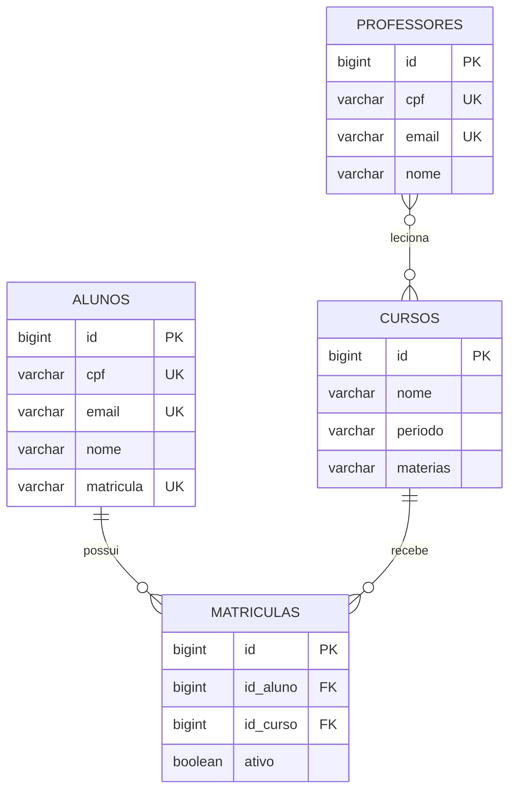

# Modelo de domínio

> No mínimo **3 entidades** e pelo menos **um relacionamento**. As linhas marcadas com *(exemplo)* mostram o nível de detalhe esperado: apague e escreva as do grupo.

## Entidades

Uma tabela por entidade. A coluna **Regra** é o que vira `NOT NULL`, `UNIQUE` ou validação no DTO.

### Aluno

Um estudante pode se matricular em vários cursos

| Atributo    | Tipo Java | Coluna      | Obrigatório | Regra                           |
|-------------|-----------|-------------|-------------|---------------------------------|
| `id`        | `Long`    | `id`        | sim         | Gerado pelo banco               |
| `cpf`       | `String`  | `cpf`       | sim         | CPF único e válido do estudante |
| `email`     | `String`  | `email`     | sim         | Único, até 255 caracteres       |
| `nome`      | `String`  | `nome`      | sim         | Até 255 caracteres              |
| `matricula` | `String`  | `matricula` | sim         | Gerado no cadastro              |
| ...         | ...       | ...         | ...         | ...                             |

### Professor

Professor de uma ou mais matérias

| Atributo    | Tipo Java | Coluna      | Obrigatório | Regra                           |
|-------------|-----------|-------------|-------------|---------------------------------|
| `id`        | `Long`    | `id`        | sim         | Gerado pelo banco               |
| `cpf`       | `String`  | `cpf`       | sim         | CPF único e válido do estudante |
| `email`     | `String`  | `email`     | sim         | Único, até 255 caracteres       |
| `nome`      | `String`  | `nome`      | sim         | Até 255 caracteres              |
| ...         | ...       | ...         | ...         | ...                             |

### Curso

Um curso específico, pertence a uma instituição, pode ter vários alunos

| Atributo   | Tipo Java | Coluna     | Obrigatório | Regra                                    |
|------------|-----------|------------|-------------|------------------------------------------|
| `id`       | `Long`    | `id`       | sim         | Gerado pelo banco                        |
| `nome`     | `String`  | `nome`     | sim         | Até 255 caracteres                       |
| `materias` | `String`  | `materias` | sim         | Uma lista de matérias separadas por ,    |
| `status`  | `String`  | `status`  | sim   | Pode ser `Ativo`, `Em planejamento`, `Inativo`   |
| `numeroVagas`  | `Int`  | `numero_vagas`  | não   | Deve ser um número maior que >0          |
| `periodo`  | `String`  | `periodo`  | não         | Deve ser MATUTINO, VESPERTINO ou NOTURNO | 
| ...        | ...       | ...        | ...         | ...                                      |

> TO-DO: "instancia" do curso. Mover status do curso. Considerar status da instancia no futuro

## Matricula Do Aluno

Tabela de relacionamento de Aluno <-> Curso

| Atributo   | Tipo Java | Coluna     | Obrigatório | Regra              |
|------------|-----------|------------|-------------|--------------------|
| `id_aluno` | `Long`    | `id_aluno` | sim         | FK para alunos     |
| `id_curso` | `Long`    | `id_curso` | sim         | FK para cursos     |
| `status`    | `String` | `status`       | sim         | Pode ser `Ativo`, `Matriculado`, `Afastado`, `Trancado` e `Concluido` |
| ...        | ...       | ...        | ...         | ...                |

## Matricula Do Professor

Tabela de relacionamento de Professor <-> Curso

| Atributo   | Tipo Java | Coluna     | Obrigatório | Regra              |
|------------|-----------|------------|-------------|--------------------|
| `id` | `Long`    | `id_aluno` | sim         | PK para alunos     |
| `id_professor` | `Long`    | `id_aluno` | sim         | FK para alunos     |
| `id_curso` | `Long`    | `id_curso` | sim         | FK para cursos     |
| `status`    | `String` | `status`       | sim         | Pode ser `Ativo`, `Matriculado`, `Afastado` e `Concluido` |
| ...        | ...       | ...        | ...         | ...                |

> TO-DO: Melhorar o termo `MATRICULADO` do status do professor. Considerar quando ele sair no meio

## Relacionamentos

| De        | Para  | Tipo           | No banco                                      | No código                   |
|-----------|-------|----------------|-----------------------------------------------|-----------------------------|
| Matricula | Aluno | muitos para um | `matriculas.id_aluno` referencia `alunos(id)` | `@ManyToOne` em `Matricula` |
| Matricula | Curso | muitos para um | `matriculas.id_curso` referencia `cursos(id)` | `@ManyToOne` em `Matricula` |
| ...       | ...   | ...            | ...                                           | ...                         |

## Diagrama ER

O GitHub desenha o bloco abaixo sozinho. Troque pelas tabelas do grupo, com os nomes das colunas como estarão no banco (`snake_case`).

Como ler: `||--o{` é "um para muitos". Um leitor faz zero ou vários empréstimos, e cada empréstimo é de exatamente um leitor.

## Migrations

Todas existem em `src/main/resources/db/migration`, uma tabela por arquivo. A ordem importa: a tabela referenciada nasce antes da que referencia.

| Versão         | Arquivo                     | O que cria                                            |
|----------------|-----------------------------|-------------------------------------------------------|
| V1 *(exemplo)* | `V1__criar_livros.sql`      | Tabela `livros`                                       |
| V2 *(exemplo)* | `V2__criar_leitores.sql`    | Tabela `leitores`                                     |
| V3 *(exemplo)* | `V3__criar_emprestimos.sql` | Tabela `emprestimos`, com as duas chaves estrangeiras |
