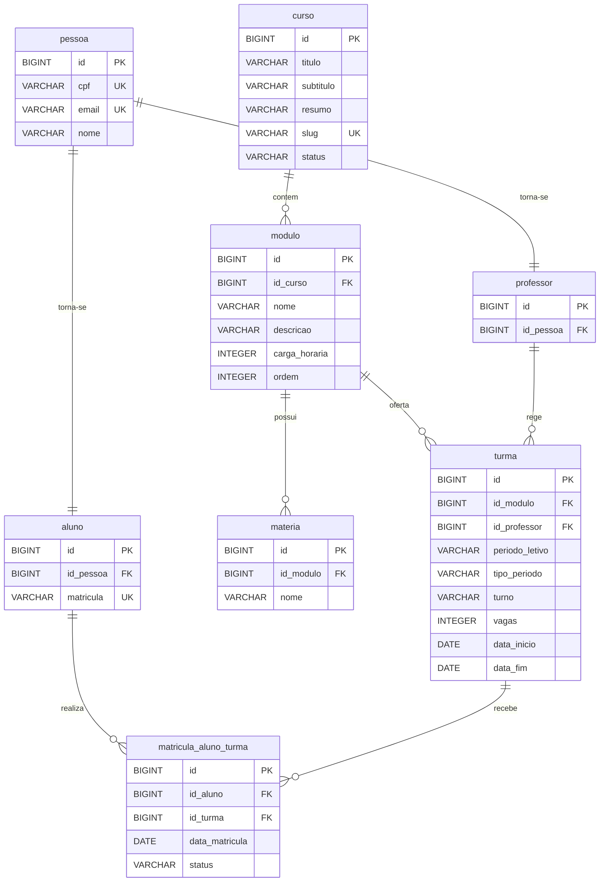

# Modelo de domínio

## Entidades

Uma tabela por entidade. A coluna **Regra** é o que vira `NOT NULL`, `UNIQUE` ou validação no DTO.

### Pessoa

| Atributo    | Tipo Java | Coluna      | Obrigatório | Regra                           |
|-------------|-----------|-------------|-------------|---------------------------------|
| `id`        | `Long`    | `id`        | sim         | Gerado pelo banco               |
| `cpf`       | `String`  | `cpf`       | sim         | CPF único e válido da pessoa    |
| `email`     | `String`  | `email`     | sim         | Único, até 255 caracteres       |
| `nome`      | `String`  | `nome`      | sim         | Até 255 caracteres              |

### Aluno

Um estudante pode ter várias matrículas ao longo do tempo, mas só uma delas ocupando vaga (`MATRICULADO` ou `ATIVO`) por vez.

| Atributo    | Tipo Java | Coluna      | Obrigatório | Regra                                    |
|-------------|-----------|-------------|-------------|------------------------------------------|
| `id`        | `Long`    | `id`        | sim         | Gerado pelo banco                        |
| `pessoa`    | `Pessoa`  | `id_pessoa` | sim         | FK para pessoa                           |
| `matricula` | `String`  | `matricula` | sim         | Única, gerada no cadastro (ano + dígito do período + id da pessoa + 4 dígitos aleatórios), máximo 64 caracteres |

### Professor

Professor de uma ou mais turmas

| Atributo    | Tipo Java | Coluna      | Obrigatório | Regra                           |
|-------------|-----------|-------------|-------------|---------------------------------|
| `id`        | `Long`    | `id`        | sim         | Gerado pelo banco               |
| `pessoa`    | `Pessoa`  | `id_pessoa` | sim         | FK para pessoa                  |

### Curso

Um curso específico, pertence a uma instituição. Ele age como um catálogo.

| Atributo           | Tipo Java         | Coluna            | Obrigatório | Regra                                         |
|--------------------|-------------------|-------------------|-------------|-----------------------------------------------|
| `id`               | `Long`            | `id`              | sim         | Gerado pelo banco                             |
| `titulo`           | `String`          | `titulo`          | sim         | Máximo 128 e no minimo 2 caracteres           |
| `subtitulo`        | `String`          | `subtitulo`       | não         | Máximo 255 e no minimo 2 caracteres           |
| `resumo`           | `String`          | `resumo`          | não         | Máximo 1024 e no minimo 16 caracteres         |
| `slug`             | `String`          | `slug`            | sim         | Deve ser caracteres alfanuméricos e '-' como caracter especial apenas, deve ser único e tem no máximo 128 caracteres e no mínimo 2 caracteres      | 
| `status`           | `Curso.enumStatusCurso` | `status`    | sim         | Enum aninhado em `Curso`, gravado como texto. Pode ser RASCUNHO, PUBLICADO e ARQUIVADO                          | 

## Módulo de um curso

Cada curso tem um módulo ou disciplina que será lecionadas no curso.

| Atributo           | Tipo Java         | Coluna            | Obrigatório | Regra                                         |
|--------------------|-------------------|-------------------|-------------|-----------------------------------------------|
| `id`               | `Long`            | `id`              | sim         | Gerado pelo banco                             |
| `curso`            | `Curso`           | `id_curso`        | sim         | FK para `curso`                               |
| `nome`             | `String`          | `nome`            | sim         | Máximo 128 e no minimo 2 caracteres           |
| `descricao`        | `String`          | `descricao`       | não         | Máximo 1024 e no minimo 16 caracteres         |
| `cargaHoraria`     | `Int`             | `carga_horaria`   | sim         | Deve ser maior que zero                       |
| `ordem`            | `Int`             | `ordem`           | sim         | Deve ser maior que zero e é unico com curso (`uq_modulo_curso_ordem`) |

## Matéria de um módulo

Cada módulo tem matérias obrigatórios que seram ensinadas.

| Atributo           | Tipo Java         | Coluna            | Obrigatório | Regra                                         |
|--------------------|-------------------|-------------------|-------------|-----------------------------------------------|
| `id`               | `Long`            | `id`              | sim         | Gerado pelo banco                             |
| `modulo`           | `Modulo`          | `id_modulo`       | sim         | FK para `modulo`                              |
| `nome`             | `String`          | `nome`            | sim         | Máximo 128 e no minimo 2 caracteres e unica com modulo (`uq_materia_modulo_nome`) |

## Turma

A turma representa efetivamente o acontecimento de um módulo em um período letivo. Ela tem alunos e professor. Para matricular, o aluno escolhe o curso e a API encontra a turma aberta dos módulos desse curso.

| Atributo           | Tipo Java         | Coluna            | Obrigatório | Regra                                            |
|--------------------|-------------------|-------------------|-------------|-----------------------------------------------|
| `id`               | `Long`            | `id`              | sim         | Gerado pelo banco                                |
| `modulo`           | `Modulo`          | `id_modulo`       | sim         | FK para `modulo`                                 |
| `professor`        | `Professor`       | `id_professor`    | sim         | FK para `professor`                              |
| `periodoLetivo`    | `String`          | `periodo_letivo`  | sim         | Gerado automaticamente dentro do padrao `YYYY/p`, até 10 caracteres. `p` = (mês de início - 1) / meses do período + 1 |
| `tipoPeriodo`      | `EnumTipoPeriodoTurma` | `tipo_periodo`    | sim         | Pode ser BIMESTRE (2 meses), TRIMESTRE (3), QUADRIMESTRE (4) e SEMESTRE (6) |
| `turno`            | `EnumTurnoTurma`  | `turno`           | sim         | Pode ser MATUTINO, VESPERTINO, NOTURNO e INTEGRAL |
| `vagas`            | `Integer`         | `vagas`           | sim         | Deve ser maior que zero                          |
| `dataInicio`       | `LocalDate`       | `data_inicio`     | não         | Tem que ser >= hoje (no cadastro e na atualização). Turma sem data de início não é considerada aberta |
| `dataFim`          | `LocalDate`       | `data_fim`        | não         | Exige `dataInicio`, deve ser posterior a ela e no máximo `dataInicio` + duração do período |

## Matricula Aluno Turma

Tabela de relacionamento de Aluno <-> Turma

| Atributo   | Tipo Java | Coluna     | Obrigatório | Regra              |
|------------|-----------|------------|-------------|--------------------|
| `id`       | `Long`    | `id`       | sim         | Gerado pelo banco  |
| `aluno`    | `Aluno`   | `id_aluno` | sim         | FK para `aluno`    |
| `turma`    | `Turma`   | `id_turma` | sim         | FK para `turma`    |
| `dataMatricula` | `LocalDate` | `data_matricula` | sim         | Gerada automaticamente (data de hoje)     |
| `status`    | `EnumStatusMatricula` | `status`       | sim         | Gravado como texto (até 20 caracteres). Pode ser `ATIVO`, `MATRICULADO`, `AFASTADO`, `TRANCADO` e `CONCLUIDO`. `MATRICULADO` e `ATIVO` ocupam vaga; nasce como `MATRICULADO`; `CONCLUIDO` não muda mais |

## Relacionamentos

| De (Origem) | Para (Destino) | Tipo de Relacionamento | No Banco de Dados (FK / Constraints) | No Código Java (JPA Annotation) |
| :--- | :--- | :--- | :--- | :--- |
| **MatriculaAlunoTurma** | Aluno | Muitos para Um (`M:1`) | `matricula_aluno_turma.id_aluno` referência `aluno(id)` | `@ManyToOne` em `MatriculaAlunoTurma` |
| **MatriculaAlunoTurma** | Turma | Muitos para Um (`M:1`) | `matricula_aluno_turma.id_turma` referência `turma(id)` | `@ManyToOne` em `MatriculaAlunoTurma` |
| **Aluno** | Pessoa | Um para Um (`1:1`) | `aluno.id_pessoa` referência `pessoa(id)` | `@OneToOne` em `Aluno` |
| **Professor** | Pessoa | Um para Um (`1:1`) | `professor.id_pessoa` referência `pessoa(id)` | `@OneToOne` em `Professor` |
| **Modulo** | Curso | Muitos para Um (`M:1`) | `modulo.id_curso` referencia `curso(id)` | `@ManyToOne` em `Modulo` |
| **Materia** | Modulo | Muitos para Um (`M:1`) | `materia.id_modulo` referencia `modulo(id)` | `@ManyToOne` em `Materia` |
| **Turma** | Modulo | Muitos para Um (`M:1`) | `turma.id_modulo` referência `modulo(id)` | `@ManyToOne` em `Turma` |
| **Turma** | Professor | Muitos para Um (`M:1`) | `turma.id_professor` referência `professor(id)` | `@ManyToOne` em `Turma` |

## Diagrama ER

Como ler: 

- `||--o{` é "um para muitos". Um curso contem zero ou vários módulos, e cada módulo é de exatamente um curso.
- `||--||` é "um para um". Uma pessoa torna-se um aluno (ou professor), e cada aluno (ou professor) pertence a exatamente uma pessoa.

> Observações Importantes: Aluno e professor tem uma chave PK incremental e não é UK com pessoa, uma vez que em caso de troca de matricula de um aluno é possível manter o histórico de uma turma passada cuja sua matricula era diferente da atual. A regra de "uma pessoa só pode ser um aluno (ou um professor)" é garantida pelo Service no cadastro.

Prova-se tal ponto com esses casos:

- **Transferência Interna**
- **Alteração na Grade Curricular**
- **Trancamento ou Suspensão**
- **Cancelamento**

## Migrations

Todas existem em `src/main/resources/db/migration`, uma tabela por arquivo. A ordem importa: a tabela referenciada nasce antes da que referencia.

| Versão | Arquivo                     | O que cria                                                                |
|----|-----------------------------|-------------------------------------------------------------------------------|
| V1 | `V1__criar_pessoa.sql`                  | Tabela `pessoa`                                                   |
| V2 | `V2__criar_aluno.sql`                   | Tabela `aluno`, com uma chave estrangeira                         |
| V3 | `V3__criar_professor.sql`               | Tabela `professor`, com uma chave estrangeiras                    |
| V4 | `V4__criar_curso.sql`                   | Tabela `curso`                                                    |
| V5 | `V5__criar_modulo.sql`                  | Tabela `modulo`, com um chave estrangeira                         |
| V6 | `V6__criar_materia.sql`                 | Tabela `materia`, com as uma chave estrangeira                    |
| V7 | `V7__criar_turma.sql`                   | Tabela `turma`, com as duas chaves estrangeiras                   |
| V8 | `V8__criar_matricula_aluno_turma.sql`   | Tabela `matricula_aluno_turma`, com as duas chaves estrangeiras   |
| V9 | `V9__garantir_slug_unico_curso.sql` | Restrição de slug único em `curso` |
| V10 | `V10__garantir_ordem_unica_modulo_por_curso.sql` | Restrição de ordem única por curso em `modulo` |
| V11 | `V11__garantir_nome_unico_materia_por_modulo.sql` | Restrição de nome único por módulo em `materia` |
